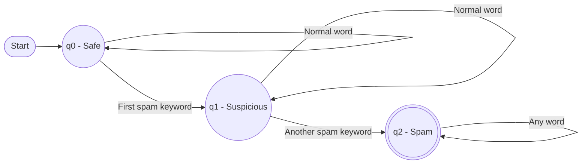

# MailGuard – Email Security and Spam Pattern Detection System

MailGuard is a web-based email security system that analyzes sender email addresses, subject lines, and message content to identify whether an email is Safe, Suspicious, or Spam using Regular Expressions, spam keyword detection, and a Deterministic Finite Automaton (DFA).

## Live Website

[Open MailGuard](https://mail-guard-email-security-qzkdcbdhu-mail-guard.vercel.app/)

## Features

- Email sender format validation using Regular Expressions
- Email content analysis
- Spam keyword detection
- DFA-based email classification
- Abnormal message sequence detection
- Safe, Suspicious, and Spam identification
- Security alerts for suspicious patterns
- Email history tracking
- Dashboard with email statistics
- MongoDB database integration

## Technologies Used

- **Frontend:** React.js, Vite, CSS
- **Backend:** Node.js, Express.js
- **Database:** MongoDB Atlas
- **Deployment:** Vercel and Render
- **Algorithm:** Deterministic Finite Automaton (DFA)
- **Validation:** Regular Expressions

## How It Works

1. The user enters the sender email address, subject, and message.
2. The system validates the sender email format using Regular Expressions.
3. MailGuard analyzes the subject and message content.
4. The system detects predefined spam keywords and counts their occurrences.
5. The DFA classifies the email into Safe, Suspicious, or Spam.
6. The system checks for predefined abnormal adjacent word sequences.
7. Security alerts and detected patterns are displayed.
8. The analysis result is stored in MongoDB and displayed in the dashboard and history.

## Email Validation Using Regular Expressions

MailGuard uses the following regular expression to validate email addresses:

`/^[^\s@]+@[^\s@]+\.[^\s@]+$/`

It checks whether the entered email contains a valid basic email structure, including a username, @ symbol, and domain.

## Spam Keyword Detection

The system checks for predefined spam keywords such as:

- free
- winner
- won
- prize
- urgent
- claim
- offer
- lottery
- congratulations
- cash

The number of keyword occurrences determines the DFA state.

## Classification

- **Safe (q0):** No spam keyword occurrences detected.
- **Suspicious (q1):** Exactly one spam keyword occurrence detected.
- **Spam (q2):** Two or more spam keyword occurrences detected, including repeated occurrences.

## Abnormal Message Sequence Detection

MailGuard also checks for predefined suspicious adjacent word sequences:

- claim prize
- winner claim
- urgent claim
- free cash
- won prize
- lottery winner

When one of these sequences is detected, the system classifies the email as Spam and displays an appropriate security alert.

## State Transition Diagram

MailGuard uses a Deterministic Finite Automaton (DFA) to classify emails based on spam keyword occurrences.

### States

- **q0:** No spam keyword occurrence detected (Safe).
- **q1:** One spam keyword occurrence detected (Suspicious).
- **q2:** Two or more spam keyword occurrences detected (Spam).

### State Transition Diagram

### Transition Table

| Current State | Input Condition | Next State | Classification |
|---|---|---|---|
| q0 | Normal word | q0 | Safe |
| q0 | Spam keyword | q1 | Suspicious |
| q1 | Normal word | q1 | Suspicious |
| q1 | Spam keyword | q2 | Spam |
| q2 | Any word | q2 | Spam |

### DFA Explanation

1. The initial state is q0.
2. When the first spam keyword occurs, the automaton moves from q0 to q1.
3. When another spam keyword occurs, including a repeated keyword, it moves from q1 to q2.
4. Once the automaton reaches q2, it remains in q2.
5. The final state determines the email classification.

### Sample Inputs and Outputs

| Subject and Message | Final State | Classification |
|---|---|---|
| Project meeting tomorrow | q0 | Safe |
| Free offer | q2 | Spam |
| Free | q1 | Suspicious |
| Free Free | q2 | Spam |
| Congratulations, you won a prize | q2 | Spam |
| Urgent claim – Please claim prize now | q2 | Spam |

### Sample Security Alert

**Input:**
- Sender: test@gmail.com
- Subject: Urgent claim
- Message: Please claim prize now

**Output:**
- Classification: Spam
- Final State: q2
- Keyword Occurrences: 4
- Detected Patterns: urgent, claim, prize
- Abnormal Sequences: urgent claim, claim prize
- Security Alert: Abnormal message sequence detected

## Repository

[GitHub – MailGuard](https://github.com/kanmani-12/MailGuard-Email-Security)