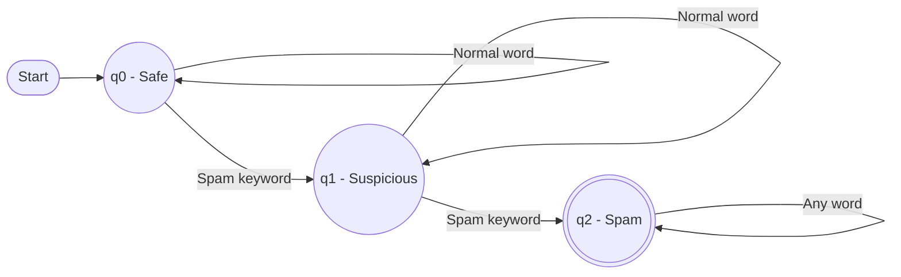

# MailGuard – Email Security and Spam Pattern Detection System

MailGuard is a web-based email security system that analyzes email content and identifies whether an email is Safe, Suspicious, or Spam using spam keyword detection and a Finite Automaton (DFA).

## Live Website
[Open MailGuard](https://mail-guard-email-security-qzkdcbdhu-mail-guard.vercel.app/)

## Features
- Email content analysis
- Spam keyword detection
- DFA-based classification
- Safe, Suspicious, and Spam identification
- Email history tracking
- Dashboard with email statistics
- MongoDB database integration

## Technologies Used
- **Frontend:** React.js, Vite, CSS
- **Backend:** Node.js, Express.js
- **Database:** MongoDB Atlas
- **Deployment:** Vercel and Render
- **Algorithm:** Deterministic Finite Automaton (DFA)

## How It Works
1. User enters the sender email, subject, and message.
2. MailGuard analyzes the email content.
3. The DFA checks for spam-related keywords.
4. The system classifies the email as Safe, Suspicious, or Spam.
5. The result is stored in MongoDB and displayed in the dashboard and history.

## Classification
- **Safe (q0):** No spam keywords detected.
- **Suspicious (q1):** One distinct spam keyword detected.
- **Spam (q2):** Two or more distinct spam keywords detected.

## Repository
[GitHub – MailGuard](https://github.com/kanmani-12/MailGuard-Email-Security)

## State Transition Diagram

MailGuard uses a Deterministic Finite Automaton (DFA) to classify emails based on spam keyword occurrences.

### States
- q0 – No spam keyword detected (Safe)
- q1 – One spam keyword occurrence detected (Suspicious)
- q2 – Two or more spam keyword occurrences detected (Spam)

### State Transition Diagram

### Transition Table

| Current State | Input Condition | Next State | Classification |
|---|---|---|---|
| q0 | Normal word | q0 | Safe |
| q0 | Spam keyword | q1 | Suspicious |
| q1 | Normal word | q1 | Suspicious |
| q1 | Spam keyword | q2 | Spam |
| q2 | Any word | q2 | Spam |

### DFA Explanation

1. The initial state is q0.
2. When the first spam keyword occurs, the automaton moves to q1.
3. When another spam keyword occurs, including a repeated keyword, it moves to q2.
4. Once the automaton reaches q2, it remains in q2.
5. The final state determines the email classification.

### Sample Inputs and Outputs

| Subject and Message | Final State | Classification |
|---|---|---|
| Project meeting tomorrow | q0 | Safe |
| Free offer | q2 | Spam |
| Free | q1 | Suspicious |
| Free Free | q2 | Spam |
| Congratulations, you won a prize | q2 | Spam |
